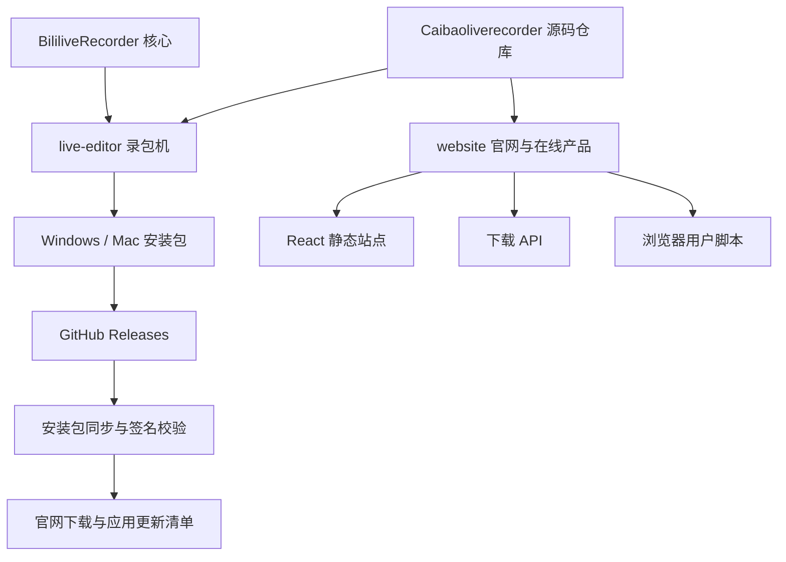

# 菜包宇宙架构

采用一个仓库、多个独立应用的结构。统一发现和阅读源码，保留各产品的依赖、运行环境和发布边界；不引入跨产品共享数据库、全局依赖安装或统一版本号。

## 应用边界

| 应用 | 技术与运行方式 | 数据位置 | 版本与发布 |
| --- | --- | --- | --- |
| 录包机 | Vue、Node、.NET 核心、原生桌面壳 | 用户本机录像与 SQLite | 独立 `v0.x` Release，沿用原打包脚本 |
| 官网与在线产品 | React / Vite，口播录制在浏览器完成 | 浏览器本地状态；无跨产品账号库 | 静态构建，不发布桌面包 |
| 下载 API | Node、Chromium、FFmpeg、Sharp | 有界临时工作目录、进程内会话 | 独立容器 build id |
| 安装包同步 | Node、GitHub 读取、COS 上传 | 独立 catalog 与同步状态 | 定时服务，只同步录包机 |

网站和桌面服务不能直接互相导入代码，也不能共享生产数据目录。安装包同步使用公开 Release 和签名清单连接两者，而不是依赖录包机运行进程。

## 为什么保留录包机现有目录

`live-editor/`、`BililiveRecorder.*` 和相关工程路径已经被 Windows / Mac 打包、许可收集、核心构建与源码归档引用。本次通过新增 `website/` 统一仓库，不搬动这些路径，不改变仓库 slug、Release 标签、安装包名称、软件版本、签名公钥或更新地址。

`SOURCE-README.md` 与 `SOURCE-MANIFEST.json` 保留历史源码导入信息，不是当前全仓库清单；正式源码包由发布脚本重新生成清单。

录包机内部已有职责模块；其后台平铺文件与发布白名单相关，不为了目录外观强行分层。参见 [录包机架构](../live-editor/docs/ARCHITECTURE.md)。网站按产品与后台职责重新归类，参见 [网站架构](../website/docs/ARCHITECTURE.md)。

## 修改从哪里开始

| 需求 | 入口 |
| --- | --- |
| 首页、产品介绍、产品菜单 | `website/src/features/catalog/` |
| 下载解析、选择、预览或相册保存 UI | `website/src/features/downloader/` |
| 下载源解析或文件传输 | `website/server/downloader/` |
| 口播文稿或浏览器录制 | `website/src/features/teleprompter/` |
| 插件详情、浏览器脚本 | `website/src/features/plugins/`、`website/public/plugins/` |
| 录制恢复、时间轴或导出 | `live-editor/src/`、`live-editor/server/` |
| 官网安装包同步 | `website/scripts/sync-releases.mjs`、`website/deploy/products.json` |
| 桌面发行版 | `live-editor/scripts/`、`live-editor/docs/RELEASE.md` |

## 验证和发布

网站有独立的 GitHub Actions 检查，只安装 `website` 依赖，验证格式、边界、业务测试和生产构建。录包机沿用自己的 Windows / Mac 检查；网站变更不触发桌面打包。发布工作流继续需要显式触发。

每个模块的测试和构建在自身目录运行。修改共享协议时验证两端，尤其是浏览器 Worker、下载 API 和录包机更新清单；单纯修改网站不能修改录包机更新版本。

生产发布与源码合并分开。网站需使用不可变部署目录、受保护 catalog、健康检查与可回退的版本切换；本次整理不发布新安装包，不重启线上服务。
